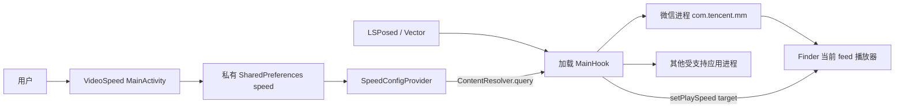

## 1.2.39：規則、診斷與計時擴充

設定 schema 在原有 speed／enabled／idle 鍵外新增 idle.app.*（繼承／停用／分鐘）、policy.app.*（原規則／換媒體重設／固定）、idle.playing.*（試驗播放限定），由 UI、備份與 Hook 共用解析。Root 接收端也再次核對各 App 停用規則與暫停狀態。timer.* 保存 boot_count 及 elapsedRealtime 秒數，跨開機失效且不匯出；睡眠請求仍使用五秒時效與可撤銷 Binder 憑證。

抖音 Provider 成功路徑可快取；ContentObserver 及 prepare 使快取失效，背景刷新採代次檢查避免舊結果覆蓋新失效。首讀／失敗備援仍可能同步執行。Reader 保留 XSharedPreferences 優先。播放限定模式用弱引用播放器進度取樣，不讀畫面內容，無進度時凍結並保留剩餘時間。

Root guard protocol=3：heartbeat 原子發布 PID＋elapsedRealtime 秒數，shell 用 /proc/uptime 與程序 PID 同時核對；僅有程序、沒有相符服務心跳時亦可重啟服務。各 Android user 與日誌輪替已納入腳本檢查。舊 guard 透過既有旗標退出再切換，保留 force-stop 尊重行為。

Diagnostics 為 UID／包名驗證後的限長、限頻本機回報；不存在回報不代表未勾作用域。ModuleToolsActivity 將固定代碼依目前語言顯示並匯出，不使用畫面讀取或通用 Root 命令介面。繁簡中文使用 Android 資源選擇，預設簡體，Hant／Hans 與 TW／CN 資源齊全；系統語言不受模組改動。

## 1.2.38 gesture and idle-lock reliability

Device follow-up on 2026-11-22: Douyin native landscape release samples after switching video were approximately 1.242x for configured 1.23x. A UID/cmdline-verified kill of module PID 20403 recovered foreground service in 2.125 seconds as PID 12513; guard recovery count increased and the unchanged Douyin PID 20402 subsequently locked at 16:29:32.991. Original speed files were restored and checked using raw base64 reads (su terminal output expands newlines). This is one ordinary process-kill recovery trial; force-stop and reboot are separate cases. See the timestamped device-validation UPDATE_SUMMARY.

WindowInputHook shares one LSPosed hook on ViewRootImpl.WindowInputEventReceiver.onInputEvent between gesture and idle observers. It filters pointer actions, ignores key/hover input, catches observer failures independently, and never alters or retains events. Reflection failure keeps the existing Activity/Dialog fallbacks. The gesture fallback also observes concrete Activity overrides and deduplicates down-time/event-time/action snapshots. Activity pause restores held acceleration without requiring an ACTION_UP.

LongPressSpeedState tracks temporary 2x while a pointer is down rather than assuming an app-specific 350ms threshold; real Kylin 7.2.5.32 emits 2x at 303-305ms. Release resets remain protected until the next gesture or media replacement rather than expiring after one second. Reader state uses weak player keys; native manual choices remain separate. Both adapters proactively restore the chosen speed on release. DouyinPlaybackProbe reads the real IVideoInfoProvider playback position for a bounded diagnostic sample; buffering, seek and new gestures can invalidate or affect a sample.

IdleLockRequest carries a revocable Binder token and elapsedRealtime timestamp through ordered broadcast, Provider, bound-service and Activity fallback routes. Target touch/pause/resume revokes the token; the owner verifies it just before invoking Root. Provider calls and synchronous Binder transactions run on a serial background executor instead of the host UI thread. The fallback Activity executes Root in the background after resume. Module broadcast work uses the same serial executor instead of creating a thread per request. Existing UID/package/feature/Root checks and compatibility with already injected older clients remain. Cancellation covers work not yet committed to the system input command, not a power-key event already executing.

Root recovery and explicit-force-stop semantics are retained. SecurityCenter's SDK/class-monitor ANR is a separate OEM problem and is not repaired by these changes. Android-version compatibility of the private input receiver requires device verification; the fallback remains available.

## 1.2.32 process recovery

IdleLockRecovery writes an owner-private enable marker and packaged guard script under files/idle-recovery, then launches a detached root shell. The foreground service updates an epoch heartbeat every 10 seconds. The guard checks every 5 seconds and restarts only this package's foreground service if its process is missing or heartbeat is at least 20 seconds old. A PID lock prevents duplicate watchers and stale nonexistent PIDs can be replaced. Explicit owner-user (user 0) package stopped state causes the guard to exit; disabling removes the marker. No global boot files are installed. BootReceiver handles normal boot sync, which was not reboot-tested in this run.

Phone verification: UID-checked kill -9 twice recovered service in 4.29/4.35 seconds; the unchanged Douyin process subsequently locked successfully. Explicit force-stop left no module process throughout 12 seconds and released the guard lock. Disabling in MainActivity removed the marker/lock, stopped the foreground service, and left no guard process. 413 JVM checks plus 12 shell behavior groups and 15 package mapping checks pass. Source-level recovery shell tests use fake Android commands; the process independence and real locking were verified on the phone.

The SecurityCenter ANR is a separately investigated event: remote VirusScanJobService main thread waited for a class monitor held by an engine-readiness waiter. Same-class ANRs predate the new watcher; the engine package was enabled and later completed a scan. See timestamped analysis in UPDATE_SUMMARY; do not infer an OEM fix from the VideoSpeed recovery fix.

<!-- Current lifecycle: internal same-app Activity transitions preserve the last touch timestamp; real background return starts a fresh interval. 114 idle checks + 299 prior checks pass. -->
## 1.2.31 current Root execution

IdleLockRoot replaces the accessibility gateway. Only the module UID launches su; fixed commands are id -u (45-second authorization timeout) and input keyevent 223 (5-second timeout). Root authorization is private to the module. The dynamic receiver captures getSentFromUid before goAsync clears the receiver PendingResult, then validates UID/package/freshness and invokes the gateway on a worker. Root rejection, timeout and process termination are logged. No accessibility/device-admin fallback locks the screen.

The root command does not solve delivery if the module service is absent. A verified UID-targeted kill test found no process return during its first 12 seconds; automatic recovery is not confirmed. Foreground-service state and normal lock behavior are separate acceptance gates. Previous accessibility and device-admin sections below are historical.

## 1.2.29 historical accessibility implementation

IdleLockAccessibility uses GLOBAL_ACTION_LOCK_SCREEN (API 28+) and removes this module's legacy active admin on connection. It subscribes to no accessibility events and cannot retrieve window contents or perform gestures. No device-admin locking fallback remains. Android's own strong-auth requirements are preserved.

IdleLockChannel on API 34+ uses the public BroadcastOptions share-identity and ordered-broadcast APIs through reflection to retain compileSdk 33. A package-limited dynamic receiver verifies framework-supplied sender UID, supported package ownership and a fresh monotonic timestamp before invoking the shared lock gateway. Acknowledgements report the actual global-action result. IdleLockService keeps the receiver available as a foreground service only while enabled and authorized; START_STICKY and a boot receiver support recovery. MainActivity synchronizes service state after saving/importing settings and returning to foreground. Provider, explicit bound-service and source-authenticated Activity fallbacks use the same gateway for older systems. They were not reachable from the scoped Douyin process on the test phone, even with force-queryable, so are not the successful path on that phone.

112 idle infrastructure/authorization/lifecycle checks pass on JVM stubs, plus 299 prior checks. Accessibility binding and biometric unlock must be established on device; the accessibility gateway is stubbed in the JVM harness. Source checks separately confirm absence of device-admin lockNow in the gateway and the minimal accessibility XML capabilities.

# VideoSpeed 技术全景与微信视频号适配指南

> 文档定位：这是项目的技术总览、教学材料和外部 AI 上下文入口。它解释“系统为什么能工作”，而不是只给出安装步骤。
>
> 当前开发版本：VideoSpeed `1.2.12`；微信原验证范围为 `8.0.69` ~ `8.0.77`（`versionCode 3022 GP / 3040 / 3160`），`8.0.79 / 3200` 已完成播放器定位修复及设速调用验证，完整播放验收待完成。X 已验证 `12.7.1-release.0` 与 `12.27.0-prod.01`，最后更新：`2026-10-18`。

## 1. 一页读懂

### 作者视频页触发修复（1.2.12，2026-10-18）

微信 `8.0.77 / 3160` 从作者页打开作品后进入 `com.tencent.mm.plugin.finder.feed.ui.FinderProfileTimeLineUI`。旧版只匹配名称含 `FinderHome` 的 Activity，因而作者视频页没有恢复或触摸注入。`1.2.12` 将该页面加入匹配，复用原有 Activity Hook；作者视频页滑动后分别延迟 450ms、1200ms 注入，日志附带实际页面名。原有手动调速冷却规则保持不变。

Mi 14 Pro（`4236fdb8`）、微信 `8.0.77 / 3160` 已覆盖安装 `1.2.12 / 1002012`；debug 构建和 lint 通过。新微信进程 `30861` 中，作者作品打开后 `00:06:26`、`00:06:27` 的 `onResume [FinderProfileTimeLineUI]`，以及连续两次滑动后 `00:06:32`、`00:06:37` 的各两次 `touchUp [FinderProfileTimeLineUI]` 均记录 `FinderThumbPlayerProxy.setPlaySpeed(1.8)` 成功返回。该证据验证触发与 setter 调用，不等于实际播放速度的计时测量；此前配置读取差异仍待单独定位。OnePlus 13 的作者视频页路径未复测，不据此扩大验证范围；手动倍速菜单行为也未在本轮重新验收。

### 微信 8.0.79 适配进展（2026-10-16）

修复前，OnePlus 13（PJZ110）安装微信 `8.0.79 / 3200`、VideoSpeed `1.2.10`，配置速度 `1.8x`。冷启动进入 `FinderHomeAffinityUI` 后，`FinderThumbPlayerProxy.play/setPlaySpeed/setPlaySpeedRatio` 均成功挂钩，但恢复与滑动触发的主动注入出现 `holder not found`，未取得实际设速成功证据。

`1.2.11` 保留原有 holder 路径，在 RecyclerView、holder 或播放器定位失败时，遍历 decorView 下的可见视图，通过 `FinderVideoLayout.getVideoView()` / `FinderThumbPlayerProxy` 选择屏幕可见面积最大的播放器。该路径避开 RecyclerView 方法混淆，并排除不可见预加载视图；保留原有手动调速冷却与延迟触发。

当前状态：`1.2.11 / 1002011` debug 构建与 lint 通过，覆盖安装成功。重启微信后的进程 `27840` 在 `23:42:01`、`23:42:02` 通过可见播放器兜底调用 `setPlaySpeed(1.75)` 成功返回；`23:42:14` 滑动触发同一路径成功。`23:42:07` 的一次滑动触发仍出现 `video view not found`，后续触发恢复。

运行时来源为 `XSharedPreferences fallback`，读取到 `1.75`，但应用私有 `speed.xml` 为 `1.8`；该差异仍待定位。USB 调试反复断开阻碍后续验证；实际播放体验、连续切换稳定性及手动速度行为尚未完成验收。不能将 setter 成功返回视为最终播放速度的测量结果。

VideoSpeed 是一个 Android **Xposed 模块**。它同时包含两个角色：

1. 一个普通 Android 设置应用：让用户保存默认播放速度。
2. 一段由 LSPosed/Vector 注入目标应用进程的 Java Hook 代码：在播放器初始化、开始播放或切换视频时，把目标速度写入真实播放器。

微信视频号是当前最特殊的适配。微信每个新视频会重新回到 `1.0x`，旧版仅仅等待 `setPlaySpeed()` 被调用并修改参数，在微信 `8.0.69` 的 feed 流上并不可靠。当前实现改为：

```text
进入视频号 / 手指滑动结束
        ↓
FinderHome Activity 的 onResume / dispatchTouchEvent(ACTION_UP)
        ↓ 延迟 350/450/1200 ms，等待 RecyclerView 与播放器绑定完成
找到当前可见视频的 ViewHolder
        ↓
FinderVideoLayout.getVideoView()
        ↓
FinderThumbPlayerProxy.setPlaySpeed(用户配置)
```

这叫**主动注入**：不再等微信“恰好调用”速度 setter，而是在可确认的新视频生命周期点主动找到当前播放器并设速。

需要特别理解：播放器实际已经变速，不等于微信 UI 一定显示 `2x`。本模块修改的是播放器状态，不是微信速度菜单的显示状态。

## 2. 术语

| 术语 | 本项目中的含义 |
|---|---|
| Xposed | 在 Android Java/ART 方法调用前后插入逻辑的 Hook API 规范与生态 |
| LSPosed / Vector | 在 Root、Zygisk 等环境中提供 Xposed 运行时的框架实现 |
| Module | 被 LSPosed 加载的模块；VideoSpeed 的准确称呼，不是浏览器意义上的 Plugin |
| Hook | 拦截方法调用，读取或修改参数、返回值，或在调用前后执行代码 |
| 宿主/目标应用 | 被注入的应用，例如微信 `com.tencent.mm` |
| ClassLoader | Android 运行时加载 Java 类的对象；Hook 必须使用目标应用的 ClassLoader 找到目标类 |
| 混淆 | 将类名、方法名缩短或改写；微信中的 `me5.s0`、`q40` 都可能随版本变化 |
| XSharedPreferences | Xposed 提供的跨进程只读配置访问方式，让微信进程读取 VideoSpeed 的配置文件 |
| 主动注入 | 模块在播放事件后主动调用 setter，而不是只拦截宿主原本发起的 setter 调用 |
| Native Hook | 在 `.so`/C/C++ 层拦截函数；本次微信适配没有采用该路线 |

## 3. 总体架构



### 3.1 APK 中的三个入口

| 入口 | 文件 | 职责 |
|---|---|---|
| Android 应用入口 | `MainActivity.java` | 读取、展示和保存速度配置 |
| Xposed 声明 | `AndroidManifest.xml` | 声明这是 Xposed 模块、最低 API 和建议作用域 |
| Hook 入口 | `assets/xposed_init` | 指向 `io.github.MarsGao.speed.MainHook` |

`MainHook` 实现 `IXposedHookLoadPackage`。目标应用进程启动时，框架调用：

```java
handleLoadPackage(XC_LoadPackage.LoadPackageParam lpparam)
```

模块先按 `packageName` 和 `processName` 路由，只在受支持应用的主进程注册 Hook，避免把逻辑注入无关进程。

### 3.2 运行边界

设置页运行在 `io.github.MarsGao.speed` 进程；Hook 运行在微信、B 站、X 等目标应用自己的进程。两者：

- 不共享 Java 静态变量；
- 不共享 `Context`；
- 不能直接调用彼此对象；
- 通过磁盘上的 `speed.xml` 传递配置。

这是理解 `1.2.4` 修复的关键。

## 4. 技术栈

| 层 | 当前技术 |
|---|---|
| 语言 | Java 11 语法/字节码级别 |
| Android | `minSdk 26`、`targetSdk 33`、`compileSdk 33` |
| Hook API | `de.robv.android.xposed:api:82`，`compileOnly` |
| Hook 运行时 | LSPosed / Vector 等兼容实现 |
| 构建 | Gradle `8.9`、Android Gradle Plugin `8.7`、JDK 17/21 |
| 配置 | Android `SharedPreferences` + 只读 `ContentProvider`（`XSharedPreferences` 兼容回退） |
| 反射 | Java Reflection + `XposedHelpers` |
| 发布 | GitHub Actions、LSPosed 格式 Tag：`VersionCode-VersionName` |

依赖使用 `compileOnly` 很重要：Xposed API 类由设备上的框架在运行时提供，不应被作为普通运行库重复打包。

版本号由 `gradle.properties` 的 `appVersionName` 计算：

```text
versionCode = major * 1,000,000 + minor * 1,000 + hotfix
1.2.4 => 1,002,004
```

## 5. 设置是怎样进入微信进程的

### 5.1 写入端

`MainActivity` 使用普通 `SharedPreferences`：

```text
文件：shared_prefs/speed.xml
键：speed
类型：float
```

用户点击“设置”后，代码使用同步 `commit()`。只有返回 `true` 才提示成功。这里不使用旧版的“先 remove/apply 再写入”技巧，因为异步 `apply()` 会引入不必要的竞态。

### 5.2 读取端

`MainHook` 在目标应用进程中优先查询：

```java
content://io.github.MarsGao.speed.config/speed
```

Provider 在 VideoSpeed 自身进程读取私有偏好，只向其他应用暴露一个只读浮点值。这样 Android 16/SELinux 下的目标进程无需穿越 VideoSpeed 私有目录。`XSharedPreferences` 与最小文件权限仍保留为兼容回退：

```text
/data/data/io.github.MarsGao.speed/               711：可穿越，不对外列目录
/data/data/io.github.MarsGao.speed/shared_prefs/  至少 755：可穿越、可读取
/data/data/io.github.MarsGao.speed/shared_prefs/speed.xml 至少 644：可读取
```

不要把应用数据根目录设成全员可读。根目录只需要执行位来允许路径穿越；过度放宽还可能破坏 Android `run-as` 的安全检查。

### 5.3 默认值

- 普通应用 Hook 的配置兜底：`1.5f`。
- 微信专用兜底：`2.0f`。
- 用户明确设置 `1.0x` 时，微信主动注入会跳过，等价于不强制变速。

微信专用兜底并不能替代配置可读性；它只能保证读取失败时仍满足“默认 2x”的核心目标。

## 6. 通用 Hook 模式

不同应用使用不同播放器，项目没有一个对所有应用都成立的万能 setter。当前代码综合使用四类模式：

1. **精确 Hook**：已知类名、方法名和签名时，直接 `findAndHookMethod`。
2. **生命周期补设**：在 `prepare/start/play/resume` 后主动设速，处理播放器重置。
3. **参数改写**：宿主传入 `1.0f` 时，在 `beforeHookedMethod` 中替换成目标速度。
4. **反射发现**：面对混淆或多版本实现，扫描候选类和 float setter。

主要适配概况：

| 应用族 | 主要播放器/策略 |
|---|---|
| Bilibili | IjkMediaPlayer，沿 prepared/start 链定位并设置速度 |
| Twitter/X/Piko | Media3/ExoPlayer 生命周期补设与自动重置拦截，保留 legacy fallback |
| 抖音 | SimPlayer、TTPlayer 的 prepare/resume/setSpeed/setPlaySpeed |
| 小红书 | IjkMediaPlayer / RedPlayerCore |
| 微博 | MagicCubePlayer / IjkMediaPlayer |
| Instagram/Instander | 通过运行时对象和消息链定位播放器 |
| Telegram | PhotoViewer/VideoPlayer 多签名兼容 |
| 微信视频号 | Finder 当前 feed 播放器主动注入，外加诊断型候选扫描 |

核心工程原则是：**速度不是一次设置后永久有效的属性**。宿主可能在新视频、seek、resume、播放器复用或数据源切换时重置到 `1.0x`，所以必须找到合适的重复注入时机。

## 7. 微信视频号：从误判到真实路径

### 7.1 已确认的播放器链

微信 `8.0.69` 视频号使用腾讯 ThumbPlayer 体系和微信自研媒体层。当前 Java 层可控对象是：

```text
com.tencent.mm.plugin.finder.ui.FinderHomeAffinityUI
  └─ R.id.m6e / RefreshLoadMoreLayout
      └─ getRecyclerView()
          └─ 当前可见 ViewHolder（8.0.69 中见 me5.s0）
              └─ holder.o(R.id.e_k)
                  └─ FinderVideoLayout.getVideoView()
                      └─ FinderThumbPlayerProxy
                          └─ setPlaySpeed(float)
```

这里的 `R.id.m6e`、`R.id.e_k`、`me5.s0` 和 `q40` 都属于版本相关实现细节，不应被当成永久 API。

### 7.2 为什么旧思路不稳定

旧逻辑主要被动 Hook `FinderThumbPlayerProxy.setPlaySpeed/play`。问题是：

- feed 流并不保证在每个新视频开始时调用被 Hook 的旧入口；
- “Hook 注册成功”只证明方法存在，不证明运行时经过它；
- 每个新视频仍可能由内部状态机重置为 `1.0x`；
- 仅根据类名猜 ExoPlayer、LiteAV 或系统 MediaPlayer，会产生大量无命中路径。

因此，稳定性问题不是“setter 无效”，而是“没有在真实的当前播放器实例与正确时机调用 setter”。

### 7.3 当前主动注入算法

#### 触发点

- `Activity.onResume` 后延迟 `350 ms` 和 `1200 ms`；
- `Activity.dispatchTouchEvent(ACTION_UP)` 后延迟 `450 ms`。

双延迟是为了覆盖 Activity 已恢复但 RecyclerView 尚未完成布局、ViewHolder 尚未绑定播放器的窗口。滑动后的 `ACTION_UP` 则是 feed 切换的稳定外部信号。

#### 定位当前视频

1. 仅接受类名位于 Finder 包且包含 `FinderHome` 的 Activity。
2. 通过资源 ID 找到 feed RecyclerView 容器。
3. 尝试混淆方法 `LayoutManager.w()` 或标准 `findFirstVisibleItemPosition()` 获取当前位置。
4. 尝试 `q0(position, false)` 或标准 `findViewHolderForAdapterPosition()` 获取 holder。
5. 最后遍历可见 child，寻找当前已知 holder `me5.s0`。
6. 从 holder 取得视频布局，再调用 `getVideoView()` 得到真实播放器代理。

#### 设置速度

`applyWeChatTargetSpeed()` 按顺序尝试常见 setter：

```text
setRate
setSpeed
setPlaySpeed          <- 当前 FinderThumbPlayerProxy 实际命中
setPlaybackSpeed
setPlaybackRate
setPlaySpeedRatio
setVideoSpeedRatio
tpSetPlaySpeed
setPlaybackParameters <- Media3/ExoPlayer 风格兜底
```

当前成功日志的核心形态：

```text
[VideoSpeed] FinderActivity.onResume current ...FinderThumbPlayerProxy setRate target via setPlaySpeed: 2.0
[VideoSpeed] FinderActivity.touchUp current ...FinderThumbPlayerProxy setRate target via setPlaySpeed: 1.5
```

日志里的 `setRate target via setPlaySpeed` 是历史日志措辞，真正调用的方法由 `via` 后面的名称表示。

### 7.4 重入保护与手动调速

模块主动调用 `setPlaySpeed()` 时，会再次触发已注册的 setter Hook。`ThreadLocal<Boolean> wxApplyingSpeed` 用来标记“这是模块自己发起的调用”，防止递归和误判。

手动调速保护有两层：

- setter 调用栈检测：只把明确的 `onClick`、`onTouchEvent`、`performClick` 或速度菜单类视为人工操作；
- Finder 菜单 `q40.onClick(View)`：读取 View tag 中的 Float，并开启 `3000 ms` 冷却期。

第二层依赖混淆类名，在微信 `3022 GP` 上可能注册失败。它是增强保护，不是主动注入主路径；是否兼容仍应以实际 `setPlaySpeed` 日志和播放行为判断。

### 7.5 为什么界面不显示 2x

微信速度菜单的文字、选中项和播放器内部速度可能由不同状态对象管理。本模块直接调用播放器 setter，没有同步修改菜单 ViewModel，因此可能出现：

```text
实际播放：2.0x
微信菜单：仍无 2x 标记或仍显示默认状态
```

这是当前设计的已知表现，不代表注入失败。若未来要同步 UI，需要额外定位微信速度菜单状态模型，维护成本和版本耦合都会明显增加。

## 8. 本次升级改变了什么

本轮不是一次单点修补，而是 `1.2.2 -> 1.2.3 -> 1.2.4` 的两阶段收敛。

### 8.1 1.2.2：诊断面扩大

- 增加 `ClassLoader.loadClass` 探针，观察 Finder/video/player/thumbplayer 候选类；
- 扫描单 float 参数的 speed/rate/playback setter；
- 在 start/play/resume/prepare 等播放点后尝试补设；
- 收紧“手动改速”的调用栈判断。

价值：证明 Java 层存在可控速度方法，并排除“热补丁导致静态分析完全失效”等误判。

局限：广谱发现能帮助找路，但不能保证拿到 feed 当前正在播放的那个实例。

### 8.2 1.2.3：从被动拦截改为主动定位

- 新增 Finder Activity resume/touch 注入器；
- 沿 RecyclerView -> 当前 holder -> video layout -> video view 找到真实实例；
- 对 `FinderThumbPlayerProxy` 主动调用 `setPlaySpeed(target)`；
- 增加手动菜单点击冷却；
- 设置保存改为单次同步 `commit()`；
- 增加微信专用 `2.0f` 兜底；
- 为跨进程读取补充目录可遍历权限。

这是“默认进入即 2x、滑到下一条仍回到默认速度”真正稳定下来的主要版本。

### 8.3 1.2.4：修正 XSharedPreferences 可见性

实机发现：配置文件内容已经是 `1.5` 或 `1.8`，但微信仍读到旧值/兜底值。原因是跨进程读取不仅要求 XML 可读，还要求路径上的每一级目录可穿越。

`1.2.4` 调整 `makePrefsReadable()`：

- 应用数据根目录保持仅 owner 可读，同时向其他进程开放执行/穿越权限；
- `shared_prefs` 目录开放读取与穿越；
- `speed.xml` 开放读取；
- 在 Activity 初始化和每次成功保存后都执行权限修正。

### 8.4 1.2.5：使用 Provider 作为主配置桥接

Ace 5 / Android 16 / Vector 实测表明，即使设置页已保存 `1.5`，微信进程仍可能无法读取私有 XML 并回退到微信旧默认 `2.0`。`1.2.5` 使用标准 Android `ContentProvider` 在进程边界传递只读配置，所有 Hook 目标统一优先使用该桥接；文件读取只保留为兼容回退。

### 8.5 1.2.6：处理晚加载模块的上下文获取

部分 Vector 目标进程会在 `Application.attach()` 之后才加载模块。配置桥接因此还会从 `ActivityThread.currentApplication()` 获取当前应用上下文，确保 Provider 查询不因错过 `attach()` 而退回旧文件读取。

### 8.6 1.2.9：动态资源解析与通用 ViewHolder 解耦（适配微信 8.0.77+）

在微信 `8.0.77`（`versionCode 3160` 大陆版）中，AAPT2 编译导致资源 ID 重排（`m6e` 由 `0x7f093e42` 变更为 `0x7f095aa3`，`e_k` 由 `0x7f090930` 变更为 `0x7f0922cb`），同时 Feed ViewHolder 类名混淆为 `yr5.s0`。`1.2.9` 重构了注入逻辑：

- **动态资源 ID 解析**：通过 `getWeChatResId(context, name, type)` 调用 `Resources.getIdentifier(...)` 动态解析并带内存缓存，同时配合 DecorView 递归遍历兜底；
- **通用 ViewHolder 探测**：摒弃对特定混淆类名（如 `me5.s0`）的硬匹配，直接通过 `RecyclerView.ViewHolder` 的 `itemView.findViewById` 及视图树结构探查 `FinderVideoLayout` / `FinderThumbPlayerProxy`；
- **倍速弹窗与 UIC 支持**：新增对 `FinderSpeedControlUIC` 的点击拦截；

### 8.7 1.2.10：X 12.27.0 Media3 混淆映射适配

X `12.27.0-prod.01`（`versionCode 312270001`）继续使用 Media3，但 R8 映射已与 `12.7.1` 不同：播放器实现由 `androidx.media3.exoplayer.i1` 漂移为 `androidx.media3.exoplayer.d0`，播放参数由 `androidx.media3.common.j0` 漂移为 `androidx.media3.common.v0`。当前映射为：

```text
d0.c(v0)  <- setPlaybackParameters
d0.b()    <- prepare
v0.a      <- speed
v0.b      <- pitch
```

模块在播放参数为 `1.0x` 时替换为用户配置，并在 `prepare` 后再次补设。初始化同时在 `Application.attach` 后使用最终 ClassLoader 重试；方法级键值去重避免同一入口被重复 Hook。
- **构建链升级**：升级 AGP 至 `8.7.0` 与 Gradle `8.9`，全面兼容 JDK 21 构建环境。

因此，这次升级解决的是两个独立问题：

```text
播放稳定性：找到正确实例 + 正确注入时机 + 动态解耦版本混淆
配置稳定性：让目标进程可靠读到用户刚保存的速度
```

## 9. 被否决或降级的路线

### 9.1 ExoPlayer 不是微信视频号主路径

项目仍保留部分 ExoPlayer 兜底代码，但微信视频号 `8.0.69` 的已验证主路径是 `FinderThumbPlayerProxy`。不能因为项目中存在 ExoPlayer 代码，就推断当前 feed 使用它。

### 9.2 LiteAV/系统 MediaPlayer 不是本轮成功依据

历史版本尝试过 `TXVodPlayer`、`TXLivePlayer`、`android.media.MediaPlayer` 等路径。它们可作为其他微信视频场景或未来诊断候选，但本轮 feed 流稳定生效的证据不是这些路径。

### 9.3 Native FFmpeg/ThumbPlayer Hook 不适合作为首选

- 微信媒体库的关键速度符号未导出，难以稳定定位；
- 默认 `1.0x` 时 FFmpeg `atempo` 滤镜图未必存在可拦截节点；
- 只改音频会造成音视频不同步；
- ABI、微信版本和反调试会显著扩大维护面。

只要 Java 层仍能取得当前播放器并调用公开/反射可见 setter，就应优先 Java Hook。

### 9.4 热补丁不是本次根因

微信 Tinker 补丁会改变运行时代码来源，但已对比的 `8.0.69` base 与当时 patch 中 Finder 相关代码一致。真正的问题是 feed 播放路径和注入时机，不是“看到 patch 就推定所有静态分析失效”。

## 10. 验证方法与证据等级

不要用单一现象判断成功。推荐证据等级：

1. **用户行为**：进入视频号明显变速，滑到下一条仍按默认速度播放。
2. **运行日志**：出现当前 `FinderThumbPlayerProxy` 和目标值的 `setPlaySpeed` 成功行。
3. **配置证据**：`speed.xml` 中的 float 与日志目标值一致。
4. **注册证据**：出现 `Activity resume/touch hooks installed`。

仅有第 4 级不够：Hook 注册成功不代表运行期命中。反过来，某些 Root/框架组合不方便拉取 LSPosed 日志时，清晰且可重复的播放行为仍是有效主证据。

### 10.1 当前验证矩阵

| 设备/微信 | 已取得的证据 | 结论 |
|---|---|---|
| Xiaomi 14 Pro / `8.0.69 (3040)` | `onResume`、`touchUp` 均命中真实 `FinderThumbPlayerProxy.setPlaySpeed`；`2.0` 与 `1.5` 日志及体感一致 | 主路径完整验证 |
| OnePlus 13 / Android 16 / Vector / `8.0.72 (3085)` | VideoSpeed `1.2.10` 下进入视频号、滑动后均命中 `FinderThumbPlayerProxy.setPlaySpeed(1.75)` | 主路径完整验证；主动 RecyclerView 探测失败时 setter Hook 仍可稳定生效 |
| OnePlus 13 / `8.0.69 (3022 GP)` | 早期版本已由用户确认实际变速；`1.2.4` 已确认安装、配置保留和主 Hook 注册，`q40` 增强 Hook 有混淆漂移 | 主路径兼容，当前 `1.2.4` 的 feed 运行日志仍应在解锁进入视频号后复核 |

验证矩阵记录的是证据强度，不是永久兼容承诺。微信小版本、渠道包、热补丁和设备框架变化后都应重新取证。

### 10.2 X 当前验证矩阵

| 设备/X | 已取得的证据 | 结论 |
|---|---|---|
| Xiaomi 14 Pro / Android 16 / Vector / `12.27.0-prod.01 (312270001)` | `d0.b` 与 `d0.c(v0)` 注册成功；实际播放连续出现 `setPlaybackSpeed 1.0 -> 2.2` 与 `Media3 12.27 prepare -> 2.2` | 主路径完整验证 |
| OnePlus 13 / Android 16 / Vector / `12.27.0-prod.01 (312270001)` | VideoSpeed `1.2.10` 安装升级成功；`d0.b` 与 `d0.c(v0)` 注册成功，启动与切换视频连续出现 `1.0 -> 1.75` 与 `prepare -> 1.75` | 主路径完整验证；配置通过兼容回退读取 |
| Xiaomi 14 Pro / `12.7.1-release.0` | 旧版 `i1` 映射曾验证 `1.0x -> 1.8x` 与 prepare 补设 | 兼容路径保留 |

### 10.3 快速复测

```powershell
$adb = 'F:\MarsDesktop\#Miui\#ADB\ADB\adb.exe'
$serial = '<device-serial>'

& $adb -s $serial shell dumpsys package io.github.MarsGao.speed |
  Select-String 'versionName=|versionCode=|lastUpdateTime='
& $adb -s $serial shell dumpsys package com.tencent.mm |
  Select-String 'versionName=|versionCode=|lastUpdateTime='
```

打开 VideoSpeed、保存速度、强停并重启微信，然后从微信 UI 进入 `发现 -> 视频号`。拉取日志：

```powershell
$out = & $adb -s $serial shell su -c `
  'cat /data/adb/lspd/log/modules_*.log /data/adb/lspd/log/verbose_*.log 2>/dev/null | tail -n 5000'
$out | Select-String -Pattern `
  '\[VideoSpeed\].*(FinderInject|setRate target|manual speed)' |
  Select-Object -Last 60
```

完整设备复测步骤以 `.agents/skills/bilispeed-wechat-finder/SKILL.md` 为准。

## 11. 微信升级后的高效适配顺序

微信版本变化时，按以下顺序排查，避免重新从 native 层开始猜：

1. 记录设备序列号、系统、Root/LSPosed、微信 versionName/versionCode 和安装来源。
2. 确认模块已启用，作用域包含 `com.tencent.mm`，并真正重启微信主进程。
3. 确认是否进入 `FinderHomeAffinityUI`，播放器 UI 是否实际加载。
4. 查找 `FinderInject` 注册日志和 `setPlaySpeed` 运行日志。
5. 若有注册但无注入，依次检查 Activity 名、RecyclerView ID、当前位置方法、holder、video layout ID、`getVideoView()`。
6. 若能取得播放器但 setter 失败，只对 Finder/video/player/thumbplayer 候选类开启受限 Java 探针。
7. 更新已漂移的最小节点，关闭生产版本中的高噪声探针。
8. 只有 Java 路径被实证为不存在时，才重新评估 native 路线或标记该版本暂不支持。

### 11.1 漂移点清单

| 漂移点 | 当前值/形态 | 失效症状 |
|---|---|---|
| Finder Activity | 类名含 `com.tencent.mm.plugin.finder...FinderHome` | `onResume` 不触发注入 |
| RecyclerView 容器 ID | `2131318338 / R.id.m6e` | `recycler not found` |
| 当前位置方法 | `w()` / 标准 API | `holder not found` |
| ViewHolder | `me5.s0` 仅作最后兜底 | 遍历可见 child 仍无 holder |
| 视频布局 ID | `2131304752 / R.id.e_k` | `video layout not found` |
| 播放器 getter | `getVideoView()` | `video view not found` |
| setter | `setPlaySpeed(float)` | 无成功日志或反射调用失败 |
| 手动菜单类 | `q40.onClick(View)` | 冷却增强 Hook 注册失败 |

## 12. 代码阅读路线

建议按这个顺序阅读，先建立主干，再看历史兼容逻辑：

1. `app/src/main/AndroidManifest.xml`：模块元数据与作用域。
2. `app/src/main/assets/xposed_init`：Hook 入口类。
3. `MainActivity.java`：配置写入与权限修正。
4. `MainHook.handleLoadPackage()`：按目标包分发。
5. `hookWeChatFinderFeedSpeedInjector()`：微信主动注入触发点。
6. `applyWeChatFinderCurrentSpeed()`：定位当前 feed 播放器。
7. `applyWeChatTargetSpeed()`：速度 setter 调用与重入保护。
8. `hookWeChatClassLoaderProbe()` 等：诊断和兼容兜底，不是微信主路径的第一入口。

`MainHook.java` 历史适配较多，存在主路径、旧策略和诊断代码共存的情况。维护时应先判断某段代码属于哪一层，再决定是否修改。

## 13. 当前设计的边界与技术债

- 微信资源 ID、混淆方法和 holder 名仍有版本耦合。
- `MainHook.java` 集中了多个应用的逻辑，后续可按应用拆分，但重构必须配套多应用回归测试。
- 微信分支仍保留较多广谱/历史兜底 Hook，运行噪声和性能影响值得后续量化。
- 只读 Provider 会向本机其他应用公开当前倍速；它不提供写入接口，且不承载敏感数据。
- 设置页、Provider 与旧配置回退统一接受 `0.25x ~ 4.0x` 的有限值，异常值回退到 `1.5x`。
- 微信菜单 UI 不与播放器状态同步。
- 手动菜单增强 Hook 依赖 `q40`，混淆漂移时冷却保护可能降级。

这些技术债不应在没有回归设备和明确收益时一次性重构。当前优先级仍是：核心播放行为稳定、修改面小、版本漂移时可诊断。

## 14. 构建与发布

本机应显式使用 JDK 17 或 21；CI 使用 JDK 17，`1.2.10` 已在 JDK 21 / AGP 8.7 / Gradle 8.9 下完成 Debug 构建。Java 源与目标兼容级别为 11。

```powershell
$env:JAVA_HOME = '<JDK 17-or-21 path>'
$env:ANDROID_HOME = "$env:LOCALAPPDATA\Android\Sdk"
$env:ANDROID_SDK_ROOT = $env:ANDROID_HOME
.\gradlew.bat :app:assembleDebug
```

发布时：

1. 更新 `gradle.properties` 中的 `appVersionName`。
2. 构建并在至少一台 Root 实机验证目标应用真实行为。
3. 只提交源码、文档和发布流程相关变更。
4. 创建 `VersionCode-VersionName` Tag，例如 `1002004-1.2.4`。
5. 同步个人仓库 `origin` 与 Xposed Modules 官方仓库 `official`。
6. 确认两个仓库的 Release 和 APK 资产一致。

## 15. 给其他对话型 AI 的上下文模板

将下面内容连同相关代码片段交给外部 AI，可以显著减少从错误播放器路线重新分析的成本：

```text
项目：VideoSpeed，Android Xposed/LSPosed Java 模块，包名 io.github.MarsGao.speed。
目标：微信视频号每个新视频默认使用用户配置倍速。
当前版本：VideoSpeed 1.2.6；适配目标为微信 8.0.69，versionCode 3022 GP / 3040。

已验证主路径：
FinderHomeAffinityUI
-> R.id.m6e RecyclerView
-> 当前 ViewHolder（8.0.69 见 me5.s0）
-> holder.o(R.id.e_k)
-> FinderVideoLayout.getVideoView()
-> FinderThumbPlayerProxy.setPlaySpeed(float)

注入时机：Activity.onResume 后 350/1200ms，以及 dispatchTouchEvent ACTION_UP 后 450ms。
配置：MainActivity 写 SharedPreferences speed(float)，目标进程优先经只读 ContentProvider 查询；XSharedPreferences 仅为兼容回退。
1.2.5/1.2.6 消除了 Android 16/Vector 下微信无法跨 UID 读取私有 XML 或错过 Application.attach 而回退至旧配置读取的问题。
UI 不显示 2x 不代表失败，判断依据是播放行为和 LSPosed 日志中的 setPlaySpeed target。

已否决的首选路线：ExoPlayer 猜测、LiteAV/MediaPlayer 盲目兜底、libxffmpeg/native 符号 Hook。
升级排查顺序：作用域/进程 -> Finder Activity -> RecyclerView/holder/layout/getVideoView -> setter；最后才考虑 native。

请基于当前代码和运行日志分析，不要仅凭类名猜播放器，不要把 Hook 注册成功等同于运行时命中。
```

## 16. 文档维护规则

发生以下任一变化时，必须同步更新本文：

- 新增或移除受支持应用、播放器或 Hook 入口；
- 微信 Activity、资源 ID、holder、getter、setter 或注入时机变化；
- 配置存储、跨进程读取或权限模型变化；
- Android/Gradle/JDK/Xposed API 基线变化；
- 新版本验证矩阵或失败路线发生变化；
- 发布流程、Tag 规则或仓库同步方式变化。

更新时区分三类信息：

1. **稳定架构**：Xposed 加载链、跨进程边界、主动注入思想。
2. **当前实现**：具体类、方法、资源 ID、时间延迟。
3. **实验证据**：在哪台设备、哪个 versionCode 上看到什么行为和日志。

不要把一次探针命中直接写成永久事实，也不要让 README、维护技能和本文出现互相冲突的版本结论。


## 阅读 App TTVideoEngine 适配（2026-11-04，1.2.22）

`MainHook` 对 `com.kylin.read` / `com.phoenix.read` 分派到独立 `ReaderVideoHook`，支持子进程与 `Application.attach` 重试。SDK 方法签名来自设备 APK DEX：`setPlaybackParams(com.ss.ttm.player.PlaybackParams)`、`prepare/play/start`；补充 Surface 方法、媒体来源设置与具体 listener 类的 `onPrepared/onRenderStart/onPlaybackStateChanged`。以 Method 去重，避免加载和 attach 重复 Hook。

Surface 建立后立即及 250/750ms 补设；影片来源更新会清除上一集临时速度并标记初始化阶段，首帧之前的非 1x 速度仍视为初始化，首帧后才保留临时非默认调速。补设只修改原 PlaybackParams 的 speed，保留音高等其他字段。没有视频 Surface 的实例不改速。ThreadLocal 防重入，WeakHashMap 保存实例状态；release / detach / 新来源会清理对应重试与采样状态。

`rateProbe` 在每次首帧后最多一次，对比约 2 秒的 `getCurrentPlaybackTime` 与 `elapsedRealtime` 差值。日志包括 mediaMs、wallMs、ratio、expected；仅供诊断，缓冲、暂停、seek、快速换集都会影响样本。共享 SDK 的广告视频可能命中，纯音频与其他版本仍需单独验证。

配置根因：设备的真实文件位于 `/data/misc/apexdata/<framework-id>/prefs/io.github.MarsGao.speed/speed.xml`，设置值 3.0、权限 660；Phoenix 的 `XSharedPreferences.getFile()` 指向正确位置，却 `readable=false`。旧设置页只调整经典 dataDir/shared_prefs 路径。`SpeedPreferences.open` 按 LSPosed 新偏好 API 尝试 `MODE_WORLD_READABLE`，平台拒绝时回退私有模式；设置页在初始化及 commit 后，通过当前偏好实例的 mFile 修正实际 speed.xml 的可读性。方法只接受文件名 speed.xml，不处理其他偏好文件；公开这个单一浮点设置已取得使用者明确同意。LSPosed 官方说明：https://github.com/LSPosed/LSPosed/wiki/New-XSharedPreferences 。

两包调用 `useReaderPreferences()` 后优先 reload 并读取有效的 LSPosed 偏好，避免被过滤或排队的跨 App 查询。读取失败仍保留原 Provider / 旧偏好回退。其他 App 维持 Provider 优先；全局范围校验与 getSpeedChanged 逻辑保持原契约。attach 早期 Application context 尚未就绪时保留 base context，增加去重读取失败与一次性文件路径诊断。

固定 3x 对照证明换集 Hook 可维持倍速；修正偏好可读性后，正常设置也通过使用者验证。HMA 配置未修改，不能把规则存在当成换集失效的充分因果证据。实验性广播、私有 Provider、固定速度都已清除，最终无新增 exported receiver。

1.2.22 已覆盖安装；使用者确认 Phoenix 在 2x / 3x 下续播与换集均正常，Kylin 第一支与下一支正常。样本有 Phoenix 1.96/2.01/3.00、Kylin 3.00/2.98，仍保留较低的瞬态样本，不能将每个短样本当成稳定倍速保证。两包 Hook 各 34 项，配置/文件兼容性 20 项，共 88 项 JVM 替身检查；不是 Android instrumentation。详见设备证据及更新摘要。


## 抖音动态默认值与变更检测（2026-11-04，1.2.23）

当前设备抖音 33.9.0 切视频时会命中 SimPlayer.setSpeed，但旧 prepare/resume 刷新路径没有可靠覆盖，进程缓存会维持启动时速度。`DouyinSpeedState` 分开保存上次模块配置与当前选择，每次 setSpeed / prepare / resume 都读取最新配置；配置改变则使用新默认值，配置未变则保留原生手动选择。现有手动调用栈判据和 TTPlayer legacy 回退保留，仅修正相关堆栈索引边界。

`SpeedConfigBridge.hasSpeedChanged` 比较两次检查读到的实际速度值，不再以 XSharedPreferences.hasFileChanged 作为回退依据，防止别的 getSpeed/reload 先消费文件时间戳而漏报变更。getSpeed 的 Provider 优先策略及两个阅读 App 的可读偏好优先策略维持原状。

使用者确认同一个抖音进程内，设置修改后下一支视频会跟随；日志保存同 PID 的不同设速值。没有额外的抖音播放进度计时，其他抖音变体、原生手动速度的完整设备回归仍需后续覆盖。最终共 101 项 JVM 检查（Douyin 10、配置与文件相容性 23、两包 Hook 各 34），lint 0 errors / 20 warnings。


## 按应用独立配置（1.2.24）

`SpeedSettings` 统一解析 UI、Provider 与 XSharedPreferences 的配置；原 `speed` 全局浮点值不改，覆写键是 `speed.app.<真实包名>`。没有有效覆写时跟随全局，异常值仍执行 `0.25x ~ 4.0x` 检查并回退。显式独立值即使等于当前全局也仍保持独立，后续全局变化不会覆盖它；重置只删除该应用键。

`MainHook` 在每一个已支持分支调用 `setTargetPackage(lpparam.packageName)`，包括阅读 App 的独立入口。避免使用可能被目标 App 改写的 Context 包名，亦不使用带子进程后缀的 processName。各 Hook 原有 `getSpeedConfig/getWeChatSpeedConfig/hasSpeedConfigChanged` 都经原桥接读到本应用的有效值。

`SpeedConfigBridge` 保留阅读 App 的偏好优先与其他 App 的 Provider 优先策略。Provider URI 新增 `package` 参数；不带参数保持原全局 IPC 契约，响应仍是单列 speed，仍为只读。配置变更检查比较本应用的最终解析值，因此只改其他包名或修改全局但本应用有独立覆写时，不会清除本应用原生手动选择。

`MainActivity` 上方保存全局速度，下方 ListView 支持名称／包名搜索，显示「跟随全局」或「独立设置」与生效速度。点击应用打开编辑对话框，保存仅写一个包名键，「跟随全局」仅移除该键。显示已安装 App 的系统名称，未安装时使用内建标签；可预先配置全部 15 个已支持包名。沿用原同步 commit 与 speed.xml 可读性处理，不添加权限、服务或接收器。

本机检查：SpeedSettings 79 项、配置桥接 34 项、Douyin 状态 10 项、两个阅读 App 各 34 项，共 191 项 JVM 检查。测试覆盖旧全局资料、独立值隔离、移除覆写、同值覆写保持独立、包名／范围校验、Provider 包名路由与独立值变化检测。未进行本版 Android UI、Provider 真机查询或播放验收；此前版本的实播证据不能当成本版新增功能已验收。


## 设置操作与生命周期优化（1.2.25）

`SpeedSettings` 先检查有效覆写，仅在缺失或无效时读取全局，减少独立设置路径的一次偏好读取；包名 Pattern 作为静态常量复用。仅捕获 float 读取的 ClassCastException（例如恢复数据包含 string/int），将该键视为无效，不修改原数据、不尝试宽松转换，其他存储错误不被统一吞掉。NaN 哨兵保留，阅读 App 的失效偏好仍会继续查询 Provider。

微信旧 lastSpeedMap 只写入、读取后没有任何判断，删除整张强引用表不改变设速分支。手动保护时间存入 ManualSpeedCooldown 的同步 WeakHashMap，值只含 Long，避免值反向引用播放器；过期项查询时移除。每实例记录与检查使用 SystemClock.elapsedRealtime，不受系统时间调整影响，3 秒期限保留。Finder 注入路径另有全局手动保护，本轮不修改该路径；既有来源、成功、跳过与异常日志保留。没有测量真机堆大小，不能把代码层的引用修复当作实测内存改善。

设置页全局与独立编辑器复用快捷填入，点击只修改文本，保存才写入原 speed.xml。清单筛选与搜索组合，保存或重置后重新计算列表；恢复 Activity view state 后重新应用筛选。批次重置列出影响数量，明确包含筛选外应用，确认后只删除 xposedscope 中包名对应的 speed.app.* 键，不调用 clear，不修改全局或其他配置。

本机验证共 214 项：SpeedSettings 87、桥接与文件兼容 37、手动保护 12、Douyin 10、两阅读包各 34；新增类型异常、读取短路、Provider 回退与手动期限边界用例。新 UI、旋转后的筛选恢复、批次重置对话框、微信实播与 GC 行为仍待设备验证。本轮 ADB 看见的是 nabu 平板，查询未见模块安装；未在该平板安装或更动设置。


## 1.2.26：生命周期隔离与备份

`CurrentPlayer.resolve` 不保存首次或最近播放器。SimPlayer resume 回呼使用自身 thisObject；父级回呼扫描接收者的非 static 实例字段（含父类），只在唯一 SimPlayer 实例可辨识时设速；多个不同实例、不可访问或未知结构时不猜测，记录一次未知所有者提示，prepare/resume/setSpeed 的已知路径保留。独立 resume 安装失败不会阻止其余路径。Bilibili 去除字段顺序依赖，歧义时跳过，并移除模块设速反射失败后的主动抛错。

`TaskGeneration` 用弱键保存 owner 最新 token，实例有新工作时旧 token 失效。微信每个 resume/touch 请求共享一组延迟，后续请求使旧组失效；onPause、Activity finishing/destroyed 会跳过，闭包仅持有 Activity 弱引用。仍保留 350/1200ms resume 和 450ms touch（作者页另有 1200ms）的时机，不移除必要的晚期重试。任务仍可能留在 Looper 队列直到到期，但过期任务不会读取设置或扫描页面。阅读 App 的 Surface 补设用同样机制，媒体来源改变、detach、release 使旧工作失效；既有 rate probe token、Surface 音讯防护与回调补设保留。

`SpeedConfigBridge.refreshSelectedSpeed` 一次读取即返回配置变化后的选中值，未变化则保留原生手动值；旧 hasSpeedChanged API 与测试保留。四处原 check-then-get 路径改用此方法。没有加入时间缓存、轮询间隔或失败退避，避免延迟下一支影片的新设置。

启用标记存于同一个 speed.xml，键为 enabled.app.<packageName>，值为 float 0/1；缺失或异常类型兼容为启用。MainHook 先排除不支持包名，再于目标进程启动读取开关；明确停用时不安装播放器与页面 Hook。启动开关先尝试 XSharedPreferences，缺失后在 Context 可得时查询 Provider enabled 投影，均不可用时保留既有启用行为。没有热卸载 Hook，因此开关变更需目标进程完全重启，普通速度变更仍在下一支影片读取。Provider 原 /speed 和 speed 列不变，仅新增单列 enabled 投影；禁止写入的契约不变。

`SpeedBackup` 使用 version=1 的 UTF-8 key=value 文本，只允许全局 speed、当前支持包名的 speed.app.* 和 enabled.app.*。最多 64KiB 输入，拒绝重复、未知键/包名、错误版本与数值；解析阶段不修改配置。SAF 创建/打开文件，无新权限；预览后以一次 Editor transaction 合并或替换。替换只删除支持包名的两类键，不 clear 其他配置。速度与启用开关以明文导出，不包含其他 App 私有资料。

MainActivity 文件 I/O 与 commit 串行在后台执行；成功写入及原文件可读性处理后才回主线程刷新和提示。重复保存被阻止，Activity 销毁后不操作旧 View；新建设置以解析默认值提供 1.5x，首次未保存时不再同步写入默认键。对话框加 ScrollView；未声称覆盖全部横向或大字号排版。

验证：SpeedSettings 87、Bridge 45、ManualSpeedCooldown 12、Lifecycle/Backup 44、真实 Provider 类 29、Douyin 10、Reader 各 36，共 299 项 JVM 检查。真实 Provider 类仍用 Android API stub，但另有 emulator-5554 Android 36 实际 IPC 与设置操作证据：取消保持 1.5/启用；保存 Phoenix 3.0/停用且全局 1.5；导出含三类值；合并全局 2.2、抖音 1.8 后 Phoenix 3.0/停用不变；替换后 Phoenix 2.2/启用，抖音1.8保留；重复全局键导入被拒绝且原值不变。模拟器最初无本包，已安装本版并覆装最终产物；没有清除任何既有 App 数据或修改手机。Xposed 播放适配、真实 Hook 安装开关、性能/内存量测与完整 UI 旋转恢复仍待手机验收。
# 1.2.27 idle-lock architecture

- `MainHook.handleLoadPackage` installs `IdleLockHook` after the supported-package gate and before the speed-enable gate. LSPosed injection supplies scope membership; no LSPosed database access or scope changes are needed. The playback adapters remain independent.
- `IdleTimeout` is a pure Java monotonic state machine. `IdleLockHook` observes base Activity resume/pause/destroy/window focus and Activity/Dialog touch dispatch. The main-thread Handler keeps one pending deadline; weak references avoid retaining Activities or Dialogs. Background/focus loss cancels pending work. A held finger suppresses the deadline until release/cancel. Landscape Activity transitions get a fresh interval. Dialog focus is checked at expiry, including system overlays above dialogs.
- `SpeedSettings` adds float keys `idle.enabled` (only exact 1 enables; absent/malformed is off) and `idle.minutes` (integer 1–240; absent/malformed defaults to 10). They share the existing LSPosed-readable `speed.xml`; they contain no credentials. The hook reloads a snapshot on foreground/focus entry, without periodic preference polling.
- `IdleLockAdmin` requests only the `force-lock` device-admin policy. Activation happens in Android's confirmation UI. MainActivity saves the requested enable/minutes only after activation is confirmed; cancellation does not opt the user in. The pending minutes survive Activity recreation.
- `IdleLockProvider` is separate from the existing read-only speed Provider. Its only side effect is `call("lock", packageName, null)`. The caller UID's PackageManager package list must include the claimed package, and that package must belong to `R.array.xposedscope`. It clears/restores Binder identity only after authorization, checks the persisted feature switch, active admin, interactive screen and unlocked keyguard, then calls `DevicePolicyManager.lockNow()` as the module UID. Unsupported callers cannot issue lock requests. The inactivity/foreground decision is made in the scoped host process; this is not a privileged system-wide input observer.
- Failed/blocked IPC is logged once per attempted interval; a later user touch can rearm a complete interval. No root shell commands, accessibility service, foreground service or changes to the system screen timeout are used. Actual provider visibility on a particular phone still needs runtime verification.
- `SpeedBackup` version-1 parsing accepts optional idle keys with strict validation. Export omits absent keys so old settings preserve the previous round-trip shape. Import preview shows the new values. Missing keys preserve the current idle settings even during replace; importing enabled=1 without active admin saves 0. Older app versions reject backups containing the newly added keys.
- Validation: 85 idle-lock checks (actual Hook/provider/model sources on JVM with infrastructure stubs), plus the existing 299 regression checks and the 15 package-label/manifest mapping checks. Android Debug build and lint are separate checks; actual lock timing, biometric restrictions, package visibility and vendor behavior require phone verification after user activation.
